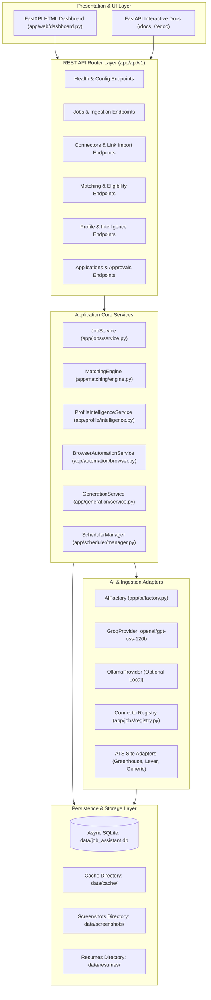
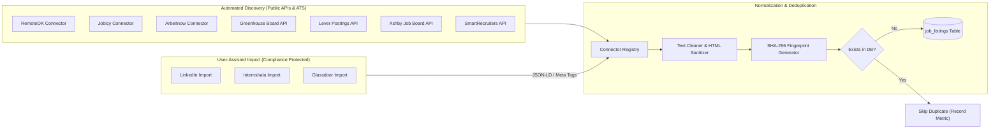
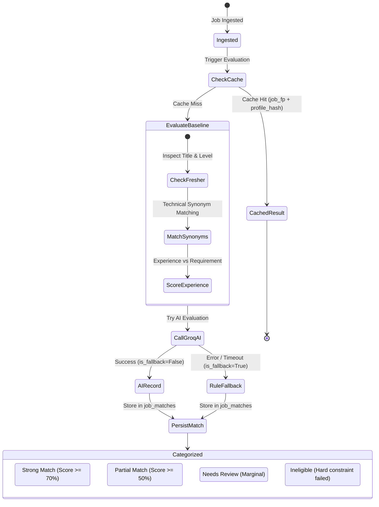
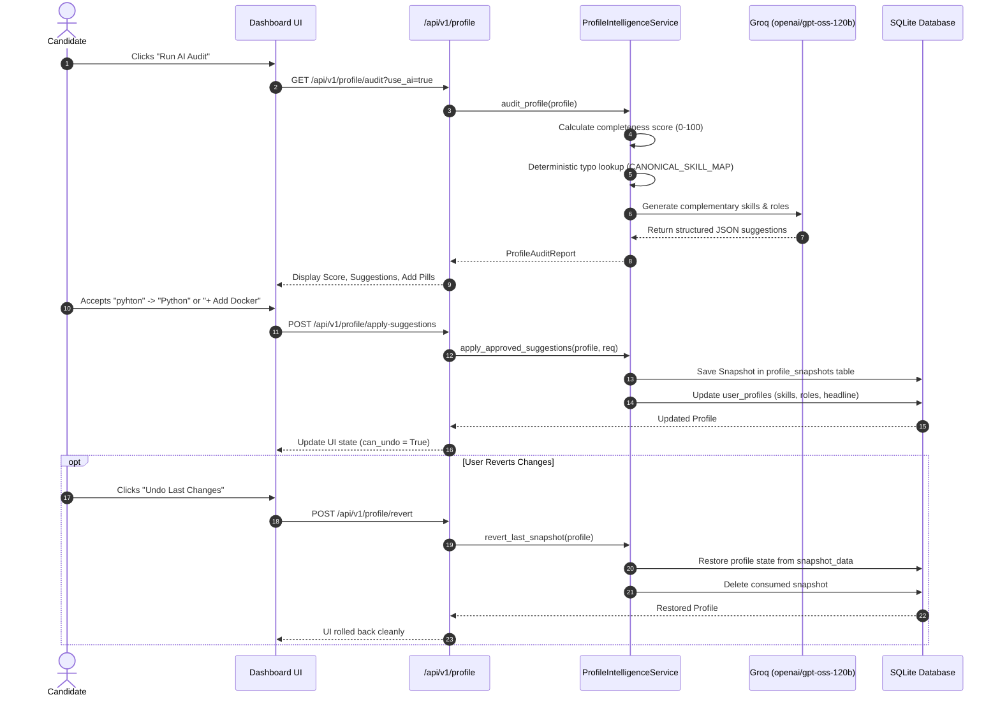
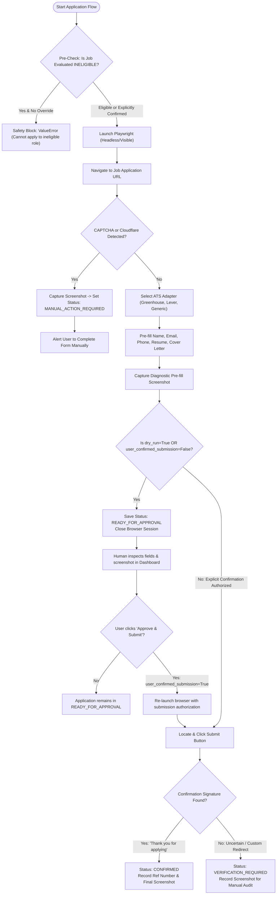
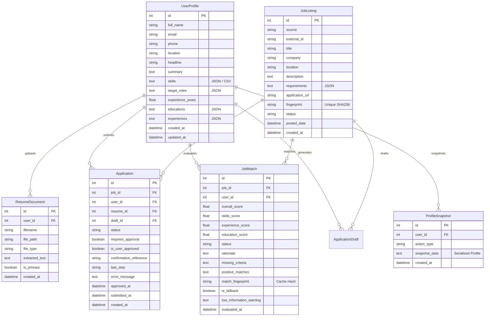

# AI Auto Job Apply — System Architecture & Design Specification

**Target System**: `D:\ai-job-assistant`  
**Technology Stack**: Python 3.11, FastAPI, Pydantic v2, SQLAlchemy 2.0 (Async/SQLite), Groq Cloud API (`openai/gpt-oss-120b`), Playwright, Tailwind CSS.  
**Specification Version**: 2.2.0  
**Status**: Fully Implemented & Verified (101 Passing Tests)

---

## 1. System Overview & Component Topology

AI Auto Job Apply is a configurable, privacy-first, fresher-friendly job discovery and application platform. The platform coordinates automated job ingestion, semantic candidate eligibility matching, AI-assisted profile enhancement, and automated ATS form pre-filling with strict human approval gates.

---

## 2. Ingestion & Connector Registry Architecture

The job discovery subsystem employs a modular plugin pattern with a centralized `ConnectorRegistry`. Sources are classified into **Automated Discovery** and **User-Assisted Import** based on compliance boundaries.

### Invariant Deduplication Strategy
To guarantee duplicate immunity across runs and pagination:
$$\text{fingerprint} = \text{SHA256}\left(\text{normalized\_url} \parallel \text{normalized\_title} \parallel \text{normalized\_company}\right)$$
- URLs are canonicalized by removing tracking parameters (`utm_*`, `ref`, `source`, `fbclid`).
- Company and job title strings are lower-cased and whitespace-trimmed.

---

## 3. AI Matching & Eligibility State Machine

Candidate matching uses a two-phase architecture:
1. **Deterministic Baseline**: Evaluates hard constraints (fresher-friendliness, minimum experience years, technical taxonomy synonyms).
2. **AI Semantic Assessment**: Groq (`openai/gpt-oss-120b`) evaluates candidate profile context against the complete job description, returning structured JSON with transparent rationale and skill gaps.

### Fresher-First Optimization Rules
- Jobs with "Junior", "Fresher", "Intern", "Trainee", "Entry-level", or 0-1 years required automatically receive an eligibility bonus (+15.0 pts).
- Freshers with 0 professional experience are never marked `INELIGIBLE` solely because preferred/optional qualifications are missing.
- Senior roles (Director, VP, Principal, Staff, 5+ years) are demoted to `NEEDS_REVIEW` or `INELIGIBLE` for fresher candidates, preventing wasted applications.

---

## 4. AI-Assisted Profile Intelligence Architecture

The Profile Intelligence subsystem assists users in standardizing technical terminology, diagnosing missing profile sections, and receiving skill recommendations—all protected by a non-destructive undo/revert workflow.

---

## 5. Auto-Apply Lifecycle & Human Approval Gate Flow

The browser automation subsystem is built on Playwright with strict human approval gates. Automated submission without explicit human consent is architecturally prevented.

---

## 6. Database Entity-Relationship Model

---

## 7. Security, Secrets & Compliance Architecture

1. **Zero Secret Leakage**:
   - Secrets are loaded via `pydantic-settings` anchored to the absolute project root `.env`.
   - Logging redaction filter (`SecretRedactingFilter`) intercepts all log records, masking strings matching `gsk_`, bearer tokens, email passwords, and database credentials with `***REDACTED***`.
   - Health and config endpoints (`/api/v1/config`, `/api/v1/health/ai`) never output raw keys; only non-reversible 8-character fingerprints (`sha256[:8]`) and presence flags are reported.
2. **SSRF (Server-Side Request Forgery) Prevention**:
   - `validate_external_url` enforces RFC 3986 compliance, permits only `http` and `https` schemes, and blocks private/local IP ranges (127.0.0.1, 10.0.0.0/8, 172.16.0.0/12, 192.168.0.0/16, loopback).
3. **Path Traversal Shield**:
   - Resume uploads and generated documents are strictly validated using `validate_file_path` against dedicated storage directories. Filenames are stripped of path delimiters (`../`, `..\`) via `sanitize_filename`.
4. **Platform Compliance Boundaries**:
   - Platforms prohibiting direct automated scraping (LinkedIn, Internshala, Glassdoor) are classified as **User-Assisted**. Automated web scraping is not performed against them; instead, users supply listing URLs, and client-permitted JSON-LD metadata extraction is performed.
